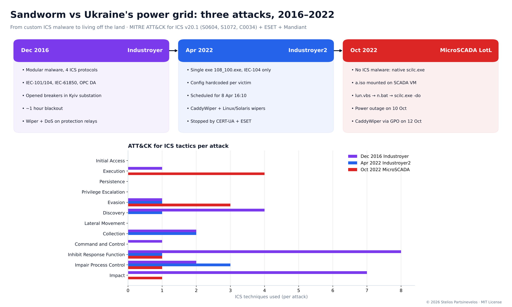

# Sandworm vs Ukraine's Power Grid: ICS Attack Analysis 2016–2022

**Industroyer (Dec 2016) → Industroyer2 (Apr 2022) → MicroSCADA living-off-the-land attack (Oct 2022)**

An analysis of how one threat actor changed the way it attacks electrical substations over six years. It includes two **MITRE ATT&CK** layers (**ICS** and **Enterprise**, v20.1), **9 Sigma rules** with Splunk SPL for the IT and OT sides, and a comparison of the three attacks.

---

## Why this project

Sandworm (GRU Unit 74455) is the only actor known to have caused **repeated power outages** with cyberattacks. Its three grid operations show a clear trend that every OT defender should know:

| | Dec 2016: Industroyer | Apr 2022: Industroyer2 | Oct 2022: MicroSCADA |
|---|---|---|---|
| **Tooling** | Modular ICS malware framework | One compact executable (`108_100.exe`) | **No ICS malware**: native SCADA tool `scilc.exe` |
| **Protocols** | IEC-101, IEC-104, IEC-61850, OPC DA | IEC-104 only, config hardcoded per victim | SCIL commands relayed over IEC-104 / IEC-101 |
| **Delivery** | Payloads + launcher on SCADA hosts | Scheduled task, planned for 8 Apr 16:10 | ISO mounted as virtual CD-ROM on the SCADA VM, `lun.vbs → n.bat → scilc.exe -do` |
| **Clean-up** | Wiper | CaddyWiper (Windows), ORCSHRED / AWFULSHRED / SOLOSHRED (Linux, Solaris) | CaddyWiper pushed by GPO two days later |
| **Outcome** | Blackout in part of Kyiv | **Stopped** by CERT-UA and ESET before impact | Unplanned outage, during mass missile strikes |
| **ATT&CK** | S0604 | S1072 | C0034 |

**The lesson:** each attack needed less custom code. By October 2022 the attacker used the victim's **own SCADA software** to send commands. Signature-based detection would not catch it: behaviour monitoring on OT hosts and **allow-listed OT network traffic** is what's left.

---

## Repository contents

| Path | What it is |
|---|---|
| [`layers/ics-layer.json`](layers/ics-layer.json) | ATT&CK for ICS layer: **31 techniques**, scored by how many of the three attacks used each one |
| [`layers/enterprise-layer.json`](layers/enterprise-layer.json) | ATT&CK Enterprise layer: **36 techniques** on the IT side (initial access, GPO abuse, wipers) |
| [`detections/sigma/`](detections/sigma) | 9 Sigma rules (Windows, Linux, Zeek) |
| [`detections/splunk_queries.md`](detections/splunk_queries.md) | The same rules converted to Splunk SPL with pySigma |
| `sandworm-grid-attacks.png` | Comparison of the three attacks + ICS tactics per attack |

## ATT&CK mapping and sources

The **ICS layer** uses the **official** MITRE ATT&CK for ICS v20.1 mappings for **S0604** (Industroyer), **S1072** (Industroyer2) and **C0034** (2022 Ukraine Electric Power Attack). I added four techniques from Mandiant's Appendix E for the October 2022 event (T0871, T0872, T0809, T0831). Every technique's comment in the layer shows which attack used it and where the mapping comes from.

The **Enterprise layer** combines the official mappings for C0034, S0693 (CaddyWiper), S1072 and S0604 with techniques I mapped from ESET's April 2022 report (marked "ESET:" in the comments). Examples are ORCSHRED's cron job and SSH spreading, the GPO deployment of CaddyWiper, and AWFULSHRED's forced reboot.

**Tactics covered (ICS):** Execution, Evasion, Discovery, Collection, Command and Control, Inhibit Response Function, Impair Process Control, Impact.
**Not covered:** ICS Persistence and Privilege Escalation. None of the three attacks has public evidence for them, so they are left empty on purpose.

## Detections

| # | Rule | Log source | ATT&CK | Level |
|---|---|---|---|---|
| 1 | MicroSCADA `scilc.exe -do` runs an external SCIL program | Windows process creation | T0871, T0894, T1218 | high |
| 2 | VBS from a non-system drive (ISO / CD-ROM) launches a hidden `.bat` | Windows process creation | T1059.005, T0895 | high |
| 3 | Executable in the `C:\Windows` root started by a scheduled task (CaddyWiper `msserver.exe` pattern) | Windows process creation | T1484.001, T1053.005, T1485 | high |
| 4 | GPO `ScheduledTasks.xml` written in SYSVOL | Windows file events (DCs) | T1484.001, T1053.005 | medium |
| 5 | Industroyer2 / ARGUEPATCH file names (`108_100.exe`, `zrada.exe`) | Windows process creation | T1053.005, T1036.005 | critical |
| 6 | Executable renamed to `.exe.MZ` (Industroyer2 stops an ops process) | Windows file events | T0881, T1489 | critical |
| 7 | Whole-disk `shred` / `dd` from `/dev/random` / SysRq forced reboot | Linux process creation | T1561.002, T1485, T1529 | critical |
| 8 | SSH attempts on ORCSHRED's unusual ports (2468, 24687, 522) | Zeek `conn.log` | T1021.004, T1110.003, T1046 | medium |
| 9 | IEC-104 (TCP 2404) from a host outside the SCADA allow-list | Zeek `conn.log` | T1692.001, T0869 | high |

Rule 1 follows Mandiant's published hunting guidance. Rule 9 is the most important OT control: **the list of hosts allowed to speak IEC-104 is short and known**, so anything else is suspicious. Replace the example IPs with your real SCADA servers.

### IOCs (SHA-1, from ESET)

| File | Description | SHA-1 |
|---|---|---|
| `108_100.exe` | Industroyer2 | `FD9C17C35A68FC505235E20C6E50C622AED8DEA0` |
| `zrada.exe` | ARGUEPATCH | `6FA04992C0624C7AA3CA80DA6A30E6DE91226A16` |
| `pa.pay` | Encrypted CaddyWiper | `9CE1491CE69809F92AE1FE8D4C0783BD1D11FBE7` |
| `link.ps1` | GPO enumeration script | `0090CB4DE31D2D3BCA55FD4A36859921B5FC5DAE` |
| `sc.sh` | ORCSHRED | `D27D0B9BB57B2BAB881E0EFB97C740B7E81405DF` |
| `wobf.sh` | AWFULSHRED | `3CDBC19BC4F12D8D00B81380F7A2504D08074C15` |
| `wsol.sh` | SOLOSHRED | `8FC7646FA14667D07E3110FE754F61A78CFDE6BC` |

## OT hardening takeaways

- **Allow-list OT protocols** (IEC-104, IEC-61850, Modbus) per source host, and alert on everything else.
- **Disable autorun and removable/virtual media** on SCADA hosts and their hypervisors. The 2022 attack started from a mounted ISO.
- Update **end-of-life SCADA software**. The SCIL-API that `scilc.exe` abused has been disabled by default since MicroSCADA 9.4 (2014).
- **Protect Group Policy**: both 2022 attacks used GPO to push wipers. Alert on GPO scheduled-task changes.
- **Separate IT and OT identity**: wipers spread wherever domain admin reaches.
- Keep **offline backups of SCADA configurations**. Wipers target recovery, not only operations.

---

## Limitations

- Initial access is **unknown** for 2016 and April 2022, and unconfirmed for October 2022. ESET and Mandiant both say so.
- The exact SCIL commands of October 2022 (`s1.txt`) were **not recovered**. "Opening breakers" is Mandiant's likely assessment.
- Rules 5 and 6 depend on file names and telemetry that OT hosts often don't have (Sysmon is rare in OT). Treat them as hunting leads.
- The rules pass pySigma validation and convert to Splunk, but have **not been tested on real OT telemetry**.
- Attribution is from ESET (high confidence, April 2022) and Mandiant (October 2022). This repo adds none of its own.

## Sources

- MITRE ATT&CK for ICS and Enterprise v20.1: S0604, S1072, C0034, S0693, G0034
- ESET, *Industroyer2: Industroyer reloaded* (12 Apr 2022, updated)
- ESET, *Win32/Industroyer: A new threat for industrial control systems* (2017)
- Mandiant, *Sandworm Disrupts Power in Ukraine Using a Novel Attack Against Operational Technology* (Nov 2023)
- CERT-UA, advisory on the April 2022 attack

## License & attribution

© 2026 Stelios Partsinevelos. Released under the MIT License (see [LICENSE](LICENSE)).

MITRE ATT&CK® is a registered trademark of The MITRE Corporation. MicroSCADA is a product of Hitachi Energy. This project is not affiliated with ESET, Mandiant, Google or Hitachi Energy, and is provided as-is for defensive and educational use.
